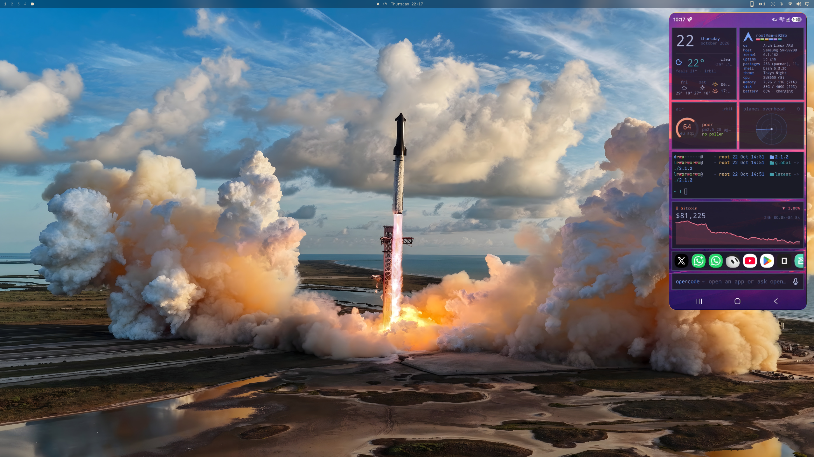

# Omarchy Phone

A window onto your real Android phone, on Omarchy (Hyprland). The phone is the computer. This is not an emulator, not Waydroid, and not Microsoft Phone Link.

Any phone `adb` can see works. A Samsung Galaxy S24 Ultra is the one this was shaped on. The window follows `adb shell wm size`, so a different panel gets a different frame.

[scrcpy](https://github.com/Genymobile/scrcpy) 5 does the video, the audio, the touch, and the keyboard. This repo picks the flags, shapes the window, and remembers a wireless address.




## What you get

The phone's screen, in a tall window. Click is touch. The keyboard types on the phone. Audio from the phone plays here.

You do not get texts, calls, photos, or notification sync. Windows Phone Link does those through Samsung's Link to Windows app, which has privileges a normal program does not. Linux cannot speak that protocol. This is the screen.

## Once on the phone

1. Settings → About phone → Software information. Tap **Build number** seven times.
2. Settings → Developer options. Turn on **USB debugging**.
3. For a cable: plug in, unlock, tap **Allow**, and check **Always allow from this computer**.

A cable is enough on its own. No wireless debugging.

### Wireless needs Wireless debugging

Same Wi-Fi is not enough. scrcpy talks to the phone over `adb`. Android only exposes that over the air when **Wireless debugging** is on (Android 11 or newer). Other apps that "just work on Wi-Fi" ship a companion on the phone. This one does not.

The switch is in Developer options → **Wireless debugging**. It usually turns **off** when the phone reboots. Pairing survives the reboot. The port does not: Android picks a new connect port each time you turn the switch on.

Pair once, while the pairing popup is open. The popup's port and the main page's port are different numbers. Use the popup for `pair`, then the main page for `connect`.

```bash
omarchy-phone pair 192.168.1.20:37123 123456
omarchy-phone connect 192.168.1.20:41234
```

`omarchy-phone mdns` lists both. After one good connect, plain `omarchy-phone` tries the saved address, then a single `_adb-tls-connect` service if that address is stale. Two phones on the same Wi-Fi: it will not guess. Pass `--serial`.

In Developer options, **Disable adb authorization timeout** keeps this computer trusted. Without it, Android drops the authorization after about a week.

## Once on the computer

```bash
sudo pacman -S --needed scrcpy android-tools android-udev
bash install.sh
```

Unplug and replug after `android-udev`. Then the bar icon, **Super+Shift+H**, or `omarchy-phone`.

`Super+Shift+P` is still Google Photos. Nothing was unbound to make room.

## Next time

Phone and PC rebooted, same Wi-Fi:

1. Turn **Wireless debugging** back on. The phone can stay locked for that switch.
2. Tap the bar icon, or press **Super+Shift+H**.

No pairing code if this PC is still authorized. If the saved port is dead and exactly one phone is advertising, the launcher finds it. If nothing is advertising, turn the switch on and look at the new port.

## Lock screen stays black

Swipe or click the mirror while the phone is locked and the window goes black. The PIN pad does not appear. That is Android, not a missed click.

From Android 12, the keyguard is a secure surface (`FLAG_SECURE`). Samsung does this. So do most phones on 12 or newer. A shell-level capture is not allowed to record it. Banking apps and Secure Folder go black for the same reason. This project does not turn that flag off.

What still works:

- Type the PIN on the PC keyboard while the window is black. Digits, then Enter if the phone wants it.
- A pattern lock has to be drawn on the phone. The mirror cannot show the dots.
- Right-click is Back. Middle-click is Home.

Once the phone is unlocked, the picture comes back.

## Security

Wireless debugging is a shell for every computer you have paired, for as long as the switch is on. This PC's key lives in `~/.android/adbkey`. Turn the switch off on a network you do not trust. USB debugging has the same power over the cable.

The phone clipboard is not copied here on its own. A password copied on the phone stays there until you paste on purpose. Ctrl+V still pastes into the phone when you ask.

There is no extra listener on the PC. The only network path is `adb` to the phone.

## Use

| Command | What you get |
|---|---|
| `omarchy-phone` | The phone panel, in a tall window. Click is touch. |
| `omarchy-phone --screen-off` | Same mirror, panel off, so the OLED stays dark. |
| `omarchy-phone desk` | A second Android screen. The physical panel is left alone. |
| `omarchy-phone desk --app com.android.settings` | Desk, and open that package. |
| `omarchy-phone camera` | Back camera. `--front` for the other one. |
| `omarchy-phone tcpip` | Cable plugged in: switch the phone to wireless, then mirror. |
| `omarchy-phone --wifi` | Prefer the Wi-Fi device when the cable is also connected. |
| `omarchy-phone --serial SERIAL` | Pick one phone when several are connected. |
| `omarchy-phone --codec h265` | Heavier codec. H.264 is the default because it fails less often. |
| `omarchy-phone doctor` | Say what is missing. |

The window opens on the right. Drag the title bar, or hold **Super** and drag, to move it. A drag without Super is a swipe on the phone.

The bar icon (a small slab, first on the right) does the same thing as **Super+Shift+H**.

The stream is H.264 at 120 fps with no video buffer. The capture is the same size as the window, so the picture fills the frame. A theme border is not drawn around it: that border is a gradient, and it made each edge a different color. Clipboard contents are not copied across by themselves.

Left **Alt** is the shortcut key inside the window. Super stays Hyprland.

- Right-click: Back. Middle-click: Home.
- Alt+o turns the phone panel off. Alt+Shift+o turns it on.
- Alt+k opens the Android keyboard layout. Do that once. UHID is a real keyboard, and One UI needs the layout.
- Alt+f fullscreen. Alt+h Home. Alt+b Back. Alt+n notifications.
- Drag a file onto the window to copy it to the phone. An APK installs.

The first launch asks the phone to trust this computer's adb key. That tap is yours.

Audio from the phone plays here and is muted on the phone. `--audio-dup` keeps both. `--no-audio` keeps it on the phone only. Audio needs Android 11.

Two ready phones: pass `--serial`. `omarchy-phone devices` lists them.

## Desk mode

`--new-display` asks Android for another screen. On some Samsung builds that screen is blank until an app is started. If the desk window stays black:

```bash
omarchy-phone desk --app com.android.settings
```

Resizing the desk window resizes that Android screen (`--flex-display`). `--fixed` turns that off.

## Develop

```bash
PYTHONPATH=. python3 -m unittest discover -s tests -v
```

Python 3 standard library only. `bash install.sh` symlinks `bin/omarchy-phone` into `~/.local/bin`, the desktop files into `~/.local/share/applications`, and `share/hypr/phone.lua` into `~/.config/hypr/phone.lua`. It copies the bar plugin into `~/.config/omarchy/plugins/firstintegral.phone` (a real directory, not a symlink). It appends `require("hypr.phone")` to `~/.config/hypr/hyprland.lua` once.

Remove that line, the symlinks, and the plugin directory to uninstall the desktop wiring. The repo can stay.
